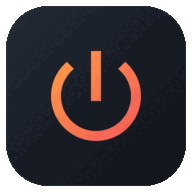
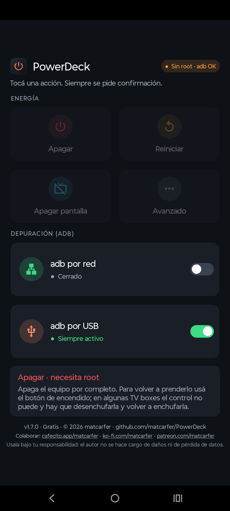

<h1 align="center">PowerDeck</h1>

<h2 align="center"><a href="https://github.com/matcarfer/PowerDeck/releases/download/v1.7.0/PowerDeck-1.7.0.apk">⬇ Download APK</a></h2>

  <a href="README.md">Español</a> · <b>English</b>  
Power and ADB menu for TV boxes, phones and tablets. Made for the remote control. 
No internet, no ads. 
<b>Compatible with Android 5 to 16.</b>

  

**Needs root** to shut down, reboot and the rest. Without root only the ADB part works.

  <a href="https://cafecito.app/matcarfer">☕ Cafecito</a> · <a href="https://ko-fi.com/matcarfer">☕ Ko-fi</a> · <a href="https://www.patreon.com/matcarfer">❤ Patreon</a> 
  <a href="https://github.com/matcarfer/library/blob/main/README.en.md">📚 Software library</a>

---

Free, closed source. Do not redistribute: share this link. No warranty. <a href="LICENSE.en">License</a> · <a href="PRIVACY.md">Privacy</a> · <a href="https://www.virustotal.com/gui/file/d0231f9b10809615171d637bb37260dc13f4efd942cbc46dccb2d78b0bdd4d80">VirusTotal</a>
