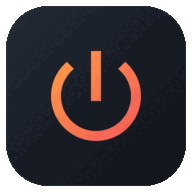
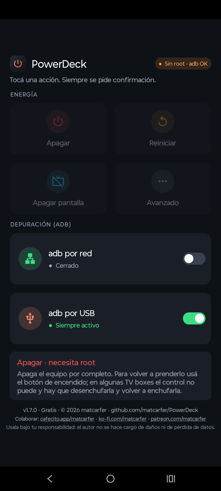

<h1 align="center">PowerDeck</h1>

<h2 align="center"><a href="https://github.com/matcarfer/PowerDeck/releases/download/v1.7.1/PowerDeck-1.7.1.apk">⬇ Descargar APK</a></h2>

  <b>Español</b> · <a href="README.en.md">English</a>  
Menú de energía y ADB para Smart TVs con Android TV o Google TV, convertidores Smart Android, celulares y tablets. En la tele se maneja con el control remoto. 
Sin internet, sin publicidad. 
<b>Compatible con Android 5 a 16.</b>

  

**Necesita root** para apagar, reiniciar y lo demás. Sin root solo funciona la parte de ADB.

  <a href="https://cafecito.app/matcarfer">☕ Cafecito</a> · <a href="https://ko-fi.com/matcarfer">☕ Ko-fi</a> · <a href="https://www.patreon.com/matcarfer">❤ Patreon</a> 
  <a href="https://github.com/matcarfer/biblioteca">📚 Biblioteca de software</a>

---

Gratis, de código cerrado. No redistribuir: compartí este link. Sin garantía. <a href="LICENSE">Licencia</a> · <a href="PRIVACY.es.md">Privacidad</a> · <a href="https://www.virustotal.com/gui/file/d6fc58dc94879111f55a324194da5c70424cc552ec45fb58bc1e8048435b3ac5">VirusTotal</a>
